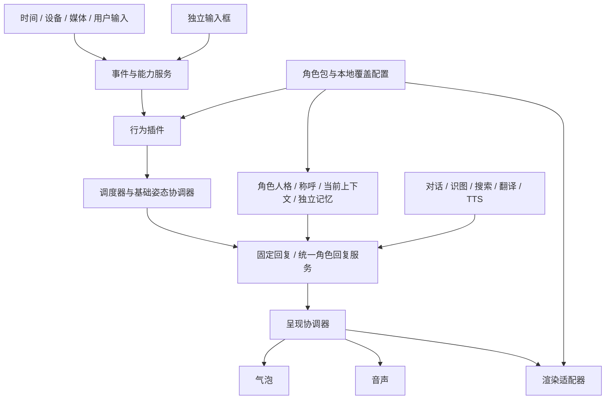

# AyaseCompanion 系统设计

版本：0.1  
日期：2026-10-26  
状态：已确认原则的设计基线；具体协议与实现细节为可验证草案  

## 1. 目标与适用范围

建立一个从零开发的桌面伙伴宿主，让角色外观、人格、行为插件、AI 能力、记忆及界面各自具有明确边界。普通用户可通过配置组合功能，角色作者可发布角色包，插件作者可在公开能力范围内增加行为，agent 可协助生成素材、配置、插件与验证证据。

采用原型法：每一轮交付可运行的垂直闭环，实测后完善设计，避免先堆积所有设置页而缺少真实运行链路。

第一版同时运行一个角色。多角色 UI 与多角色同时发声不属于初始交付范围，但所有数据、任务、回调和资源所有权从第一版就带角色实例标识。

## 2. 已确认原则

- R01：采用新宿主内核、通用能力服务、行为插件、渲染适配器和角色包的分层架构，首先实现序列帧。
- R02：记忆绑定稳定的角色实例；不绑定图片、显示名称、角色包版本或视觉模型。
- R03：宿主保留小而稳定的内核；其余能力以明确接口提供，可关闭、替换或扩展。
- R04：公共运行状态由宿主管理，业务状态由插件管理，模型内部播放状态由渲染器管理。
- R05：基础姿态与临时动作分离；基础姿态按当前有效请求重新求解。
- R06：角色必须有常规形态；透明静态图可作为单帧 idle。
- R07：动画、文字、音声独立运行，由同一个呈现任务协调完成。
- R08：角色包采用 ZIP 与根目录清单；包含外观、人格和插件推荐配置。
- R09：未知插件配置和资源保留但不执行；已安装却未配置的插件对该角色默认关闭；可选素材缺失按默认行为处理。
- R10：用户修改单独保存在本地，覆盖包内推荐配置；导出时可生成包含当前有效配置的新角色包。
- R11：构建器和宿主共享协议、校验器、配置解析与预览运行时。
- R12：最小验证使用现有 Ema 素材，覆盖导入、播放、插件、AI、记忆隔离及导出往返。
- R13：角色提供可表现能力；插件提出互动时机和目的；服务负责生成；调度与呈现负责显示和播放。
- R14：插件可请求语义动作，由角色映射到实际动画；缺少映射则保持基础姿态。
- R15：插件公共参数必须有类型、版本和校验规则，并可在界面调整。
- R16：普通插件使用固定优先级枚举；同级按照宿主接受请求的顺序执行。
- R17：已开始呈现的整条任务不被其他任务抢占；只有明确用户操作能主动中断。高优先级任务等待当前任务完整完成。
- R18：第一版单角色运行，角色之间分离记忆 bank 及本地历史、摘要、同步队列。
- R19：全屏休息指检测到其他应用全屏后，桌宠进入安静或休息状态，不是主动覆盖屏幕的强制休息界面。
- R20：独立新建工程，采用逐步完善原型的方法；既有 TrayBuddy 系列目录不再作为新项目开发目录。

## 3. 概念和身份

### 3.1 视觉模型

视觉模型提供图像或网格、动画片段、基础模式、语义动作映射、命中区域和定位锚点。它不包含时间提醒、天气判断、AI 调用、用户记忆或插件启停逻辑。

模型允许有内部动画过渡和物理状态，但这些状态不拥有系统业务决策权。

### 3.2 角色包

角色包是可分发模板，包含视觉模型、人格、角色称呼、固定台词和音声、插件推荐配置及可选推荐主题。其 packageId 和 version 用于识别模板与更新。

导入角色包不会把作者的 API 凭据、记忆身份或本机运行记录变成用户的配置。

### 3.3 本地角色实例

本地角色实例是用户实际使用的伙伴，拥有宿主生成且持久化的 instanceId。它引用某个角色包，并保存用户覆盖配置、人格调整、音色绑定、聊天历史和记忆身份。

- 同一角色包可创建多个独立实例。
- 改名、换装、更新模板默认保留原实例。
- “创建新伙伴”生成新实例及独立记忆空间。
- “更新已有伙伴”和“创建副本”必须在界面有不同入口。
- 角色包 ID 相同不代表导入操作有权覆盖所有同源实例。

插件类型 ID、插件配置实例 ID、角色实例 ID、包版本和任务 ID 不得混用。

## 4. 逻辑架构



逻辑模块不等于独立进程。第一版优先在一个桌面应用内实现清晰模块接口，只有隔离执行插件等确有需要时增加进程。

### 4.1 宿主内核

负责角色实例和插件生命周期、事件总线、业务时钟、任务队列、取消令牌、配置和资源解析、能力访问控制、持久化及诊断。内核不硬编码艾玛人格、morning 等角色状态或特定角色文件路径。

### 4.2 能力服务

提供设备时间、环境检测、HTTP 服务适配、角色回复、语音、记忆、屏幕观察、搜索、天气和日历。行为插件通过能力 ID 请求服务，不自行读取 API 密钥，不直接调用播放器和窗口底层接口。

服务提供者可替换；关闭服务后，相应插件进入待配置或按声明降级，不阻止基础角色显示。

### 4.3 行为插件

负责事件订阅、条件判断、业务计数和互动计划。例如长时间工作计时属于插件，播放抢占和角色记忆绑定属于宿主。

插件输出有限互动请求或基础姿态请求，不能直接切换当前动画、插入气泡 DOM 或调用任意系统命令。

### 4.4 呈现与窗口

呈现协调器分别驱动文字、音声和模型，并合并完成回执。窗口管理器负责 DPI、屏幕边界、拖动、焦点和锚点定位。

角色和气泡可以是同一呈现窗口内的独立组件；输入框可用单独可激活窗口。具体窗口组合在 P1 实机验证后决定，不要求一项功能对应一个窗口。

## 5. 新工程与技术基线

建议基线为 Windows、Tauri 2、Rust、TypeScript 界面和 SQLite。这是待 P0/P1 确认的实现选择，不是必须继承旧工程的约束。前端框架和具体依赖版本在原型启动时锁定，记录 ADR。

Tauri 原生插件与本项目的可导入插件包是不同概念。本项目需要自己的插件加载、规则解释和能力 API。

新工程使用独立应用标识、存储目录和数据库。已有 AI 功能以行为要求、独立业务代码及测试经验为参考重新接入；移入的工具应先消除旧 AppState、ModManager、StateManager 等依赖。

建议的后续目录边界如下，当前文档交付不代表这些源码目录已实现：

```text
AyaseCompanion/
  docs/
  contracts/              JSON Schema、接口版本和共享样例
  apps/desktop/           新桌面应用
  apps/studio/            可独立发行的制作入口，后期建立
  crates/                 Rust 内核、服务和包工具
  packages/               前端呈现、播放器、编辑组件与 SDK
  plugins/builtin/        默认插件包及其源配置
  tools/                  Ema 转换器、打包器、验证工具
  tests/                  离线测试、集成测试及桌面验收证据
  fixtures/               可确定复现的测试资源
```

## 6. 渲染机制

### 6.1 第一版序列帧

采用 Canvas 播放透明 PNG/WebP 图集或静态图。描述文件显式记录帧数、帧矩形或网格、帧时长、方向、往返规则、逻辑画布和对齐锚点。

Ema 素材可以经过独立转换器生成新描述文件；不将旧 manifest 的业务状态机直接嵌入新宿主。原有正放、倒放、往返片段应能保持视觉语义。

动画使用渲染时钟；闹钟、冷却和提醒使用后台业务时钟。隐藏窗口降低渲染频率不能导致 23 点提醒定时器失去语义。

### 6.2 统一接口和能力

基础接口包括加载、释放、枚举动作、解析语义动作、进入基础模式、播放有限片段、取消指定播放、查询边界和锚点、报告开始/完成/失败。

视线、口型、表情混合、物理和骨骼属于可选能力。宿主查询能力后再使用，不能假定每个模型都有嘴形或可叠加动作。

语义动作解析顺序建议为：当前实例显式映射 → 模型映射 → 保持当前基础姿态。没有 greeting 不触发无意义的错误弹窗。只有 idle 或可用于 idle 的静态形态是必要条件。

### 6.3 后续分件与 3D

Coopanion 式分件模型需要贴图、遮挡补画、网格、枢轴、层级、形变及物理参数，适合作为第二种渲染后端。不能把序列帧成功实验等同于已完成分件绑定或动作质量验证。

Live2D 与 3D 接入时继续使用相同任务和语义动作接口，同时通过能力声明暴露扩展参数。不要求为了统一接口而伪造不存在的能力。

### 6.4 首先选择序列帧的理由与代价

以下是基于本项目边界的工程判断，不是性能实测结论。模块化和插件机制本身不要求某一种模型格式；首版选择序列帧，是为了尽快验证调度、封装和 AI 服务之间的关系。

| 后端 | 运行所需素材 | 对当前原型的价值 | 额外工作与限制 |
| --- | --- | --- | --- |
| 序列帧 | 必需 idle；可选图集、帧序、锚点和有限动作 | Ema 素材可直接转换；播放完成边界明确；静态图也可形成闭环 | 新动作通常需要新帧；图集解码占内存；连续转向和自由形变能力有限 |
| 分件贴图 | 各部件透明贴图、遮挡补画、枢轴、网格、层级及动作参数 | 可以用程序持续驱动少量部件，适合摇摆、视线和物理表现 | 需要拆图、补画和绑定；一张完整立绘不等于已完成模型；风格和遮挡需验收 |
| Live2D | 已绑定模型、纹理、动作、表情和物理配置 | 可表达连续参数与细腻变形；可复用同一语义接口 | 制作和绑定有门槛；运行时集成、能力映射和分发条件需另外验证 |
| 3D | 网格、材质、骨骼、动作、相机及灯光 | 可提供视角与空间动作能力 | 资产制作、渲染预算、窗口效果和交互区域更复杂 |

序列帧把视觉制作质量与宿主逻辑分开测试，适合当前已有素材和最小闭环。分件贴图可能降低部分动作的逐帧素材量，但不能由此推导出素材准备总是更少或更容易。

模块化会增加协议、版本迁移、诊断和调度的实现成本；其收益是同一行为可在不同角色上复用，角色作者不必重新编写设备检测和 AI 链路。首版通过共享运行时和声明式插件控制复杂度，避免每个插件重复实现窗口或服务连接。

非抢占设计保证播放连贯，同时意味着重要提醒可能等待一条较长回复完成。通过生成长度、合理分页停留、排队有效期和明确停止入口改善体验，不能通过隐藏的自动抢占绕开已确认原则。

## 7. 事件和时间

事件统一携带事件 ID、来源、发生时间、接收时间、适用角色范围和版本。插件不能伪造用户输入来源或系统检测来源。

应用启动、系统登录、解锁、恢复运行和角色切换是不同事件。开机问候的触发来源可配置；v0.1 默认建议使用宿主初始化完成后的 app.ready，不能把每次换角色都当作系统开机。

本地时段采用开始包含、结束不包含；跨午夜时段归属需显式定义。例如 23:00—07:00 的一次性夜间提醒应按同一夜间窗口去重。

日历调度使用墙上时间及配置时区；持续时长、超时和队列等待使用单调时钟。睡眠恢复、时区变化和夏令时不能依靠渲染帧推算。

“长时间工作”提供可选统计口径：应用运行时长、设备活跃时长或用户主动开始的工作计时。默认口径待 P3 实机反馈确定。不得仅凭桌宠未被点击就宣称用户持续工作。

## 8. 优先级与非抢占调度

本节优先于旧项目中自动关怀避让、片段级抢占等历史行为。

### 8.1 固定等级

普通插件只能使用 important、normal、background。宿主保留 user 等级用于明确用户发起的互动，插件不得自报。停止操作属于控制命令，立即作用于目标任务，不进入普通队列。

插件包提供 defaultPriority，用户可按插件配置实例覆盖。优先级不绕过静音、功能关闭、能力可用性和主动打扰限制。

候选经过校验并被接受时，宿主分配严格递增的 enqueueSequence。同级按此序号排序，不采用插件提供的时间，不因 AI 返回晚而重排同级任务。

### 8.2 排队、准备与开始

任务状态至少包括 queued、preparing、ready、starting、presenting、completed、cancelled、expired、failed。

- queued/preparing/ready：尚未开始用户可见呈现，可被更高等级任务排到前面。
- preparing：AI、翻译、TTS 或资源预加载正在进行；准备不占用前台播放锁。
- ready：具备开始当前呈现策略的必要内容；流式模式可在首段已验证文字就绪时满足条件。
- starting：极短的开始临界区，宿主已分配呈现授权，正在等待实际开始回执；防止回执往返期间双播。它不能用于包住整个 AI/TTS 等待阶段。
- presenting：任一实际文字、音声或有限动作已经开始。整条任务受到非抢占保护。

开始前必须复核角色、配置版本、功能开关、触发事实、有效期和所需资源。异步结果的到达不能直接操作界面，必须经调度器授予呈现权。

同级队首仍在准备时，后面的同级任务不超车；该准备失败或超时后可继续。更高等级任务可以成为新的队首。低等级的已生成结果可保留待用，不因高等级到达就必然重做付费请求。

### 8.3 完整任务的保护

一旦开始呈现，其他插件、其他高优先级任务、全屏变化、媒体变化或普通环境事实变化均不能中断它。

第一版同一角色同时只有一个前台互动任务。其文字、音声和动画独立计时，但共同持有呈现任务所有权，防止一条任务的声音配上另一条任务的文字。

开始后到期时间不再截断任务；事实有效期和排队 TTL 只决定是否可以开始。

### 8.4 完成条件

任务完成需要所有本次启用的有限通道进入完成或已处理的失败状态：

- 文字：内容流正常结束，全部分页显示，并完成最后一页的阅读停留。
- 音声：所有计划播放的有效片段结束，或语音失败按规定完成降级。
- 动画：本次有限片段及约定收尾结束。

阅读完成后，最后一页气泡自动收起，单页回复同样处理。文字通道结束不提前结束尚在播放的音声或有限动画；等待用户输入的界面状态也不能永久持有播放锁。

普通互动动画提前完成时，恢复仍有效的循环基础姿态，不停留在末帧。若媒体在当前有限动作尚未结束时停止，则提前把恢复目标改为 idle，动作完整结束后直接显示 idle，不补播尚未重新显示的 music 退出动画。若有限动作已经结束并实际恢复到 music，则媒体停止后应在空闲的动画通道播放完整 music→idle 过渡，文字/音声继续，不能直接跳过退出片段。缺少过渡素材时才直接使用目标循环。新到的 quiet / music 进入请求仍等待整条任务交接；已开始的过渡保持完整。

上述退出片段由独立的基础过渡授权承载，不重新打开已完成的互动动画通道，不重启文字/音声。若互动各通道先结束，仍等待已开始的基础过渡结束后才开始下一条互动。停止、切换角色或关闭对应互动的插件可以撤销该授权；迟到回执不得完成新授权。

文字默认以可关闭的打字机形式显现，完整显示当页后才计算阅读停留。气泡以稳定待机姿态的可见区域为参照，下边缘与模型上方保持相对间距，宽度跟随模型比例，内容向上展开。气泡高度不超过模型可见高度及窗口剩余空间；按照实际字号和排版测量分页，放大气泡可容纳更多内容。字体大小可独立调整。

循环 idle、music 或休息基础姿态不属于有限任务。需要循环的讲话动作由任务边界限定，不能等待无限循环自行发出完成事件。

不使用“一页结束”“一句结束”作为其他插件插入的常规交接点。

### 8.5 用户主动中断

明确停止、切换角色、卸载或关闭正在执行的插件可取消相关任务。用户静音可以只终止音声通道，保留文字。发送新消息支持 interrupt-current 或 wait-current，默认值待 P2 体验确认。

鼠标经过、展开输入框、普通输入草稿和后台观察到用户活动不自动取消已开始任务。可以抑制新的主动互动。

仅后台发生的故障不能伪装成用户取消。资源无法解码、流断开等不可继续的错误按失败收尾处理，清理所有权并记录原因；这属于异常结束，不是用高优先级抢占正常任务。

操作系统挂起或锁定使呈现无法继续时，记录恢复状态，按平台可实现能力暂停/恢复，不把它作为普通插件抢占。P1/P5 必须实测音频设备、锁屏和恢复行为；不能承诺操作系统不受控时仍连续出声。

### 8.6 基础姿态协调

插件提交有所有者的 BaseClaim，包含语义模式、优先级、接受序号和有效条件。默认 idle 是没有其他有效请求时的兜底。

环境变化立即更新 desiredBase 和“是否允许新主动互动”的判断，不能抢走正在呈现的有限动作。旧非 idle 基础模式请求撤销时，按其是否仍被当前动作覆盖选择直接回退或完整退出。已实际恢复的循环退出可在文字/音声仍进行时使用空闲动画通道，appliedBase 在过渡完成后更新；该退出拥有独立 token、代次和开始授权期限。当前回复和退出片段任一尚未完成时都不授予下一条互动开始权。

交接点重新求有效 BaseClaim。需要进入/退出过渡动画时，形成可合并的有限基础转换任务；按有效优先级参与未开始任务排序。高优先级转换排在较低优先级待执行互动前，不能无条件超越 user 任务。

尚未开始的旧姿态转换合并为最新目标。例如说话期间进入全屏又退出，交接时无需播放过时的“睡下再醒来”。过渡已开始后仍受完整播放保护，新的目标在下一交接点处理。

媒体与全屏示例：媒体请求 music；全屏请求优先级更高的 quiet；当前发言完整结束后进入 quiet。退出全屏时撤销其请求，若音乐仍在播放则恢复 music，否则回 idle。

### 8.7 队列治理

去重、冷却、候选队列容量、有效期和错过触发策略均可配置并有上限。过期且未开始的互动不集中补播。基础姿态请求与重复环境事件进行合并。

第一版不自动通过“排队老化”提升插件优先级，避免改变固定等级语义。持续饥饿应在诊断中可见，供用户调整规则。

## 9. 统一 AI、人格和内容服务

所有最终面向用户的 AI 发言通过 CharacterReplyService。它从当前角色实例读取人格、角色称呼、用户称呼、语气、语言和声音偏好，统一组织上下文。

插件仅提供任务目的、触发事实、允许能力、输出长度和表现候选，不另存一份独立人格。人格修改影响随后所有相关功能。

识图提取、检索判断、翻译、日期解析等内部处理使用专用任务指令；最终发言再通过统一人格服务。工具结果、截图文字和网页材料是有来源的数据，不获得修改人格或调用权限。

支持 fixed、generated、generated-with-fallback 三种内容模式。固定模式的文字、音声和可选动作组成回复变体一起选择，不能独立随机造成错配。生成失败只有在用户配置备用内容时才采用备用内容。

语音关闭、静音或 TTS 失败时可按策略保留文字；无文字的纯音声任务允许自然失败结束。系统错误只进入状态区或诊断，不作为角色台词朗读。

对话、视觉、搜索、翻译和语音提供者通过能力接口接入，可以共用显式配置的连接，但不能把某服务凭据擅自转发给另一个服务。

## 10. 记忆与上下文

### 10.1 隔离边界

每个角色实例独立保存对话、观察、引用、滚动摘要、用户关系资料、同步 outbox、遗忘记录和长期记忆身份。即使使用同一个 SQLite 文件，也必须在查询和关联约束中强制 instanceId；原型可优先采用每实例独立数据库降低误用风险。

Hindsight 作为可选 MemoryProvider。远端 bank 由宿主创建/绑定并验证所有权，角色包和插件不能指定任意 bank。调用、同步、重建和删除都限制在当前实例的所有权范围内。

不同角色之间默认不共享个人记忆。将来可增加用户明确维护的共享资料层，但不把它混同于角色历史。

### 10.2 内容规则

保留连续对话、完整原文和有界摘要；观察与对话分别存储，通过明确引用关联。旧观察不冒充当前屏幕。

已实际显示的主动回复可进入本地历史，注明来源和显示结果；生成但未显示的候选不伪装成角色已说过的话。部分显示后由用户取消的任务标记为部分呈现。

AI 生成的问候、网页答案和模型猜测不自动变为用户长期事实。需要同步的真实用户资料与对话按记忆策略处理。

摘要失败不推进水位；遗忘后旧异步摘要或写入不能把已删除内容恢复。远端离线时使用本地上下文并保留待同步记录，不阻止基础聊天。

### 10.3 任务快照与回调

每项任务固定 instanceId、profileRevision、historyEpoch 和取消令牌。准备阶段发现相关配置或历史失效时重新确认或结束待执行任务。

呈现已经开始后，普通背景资料变化不取消它。用户修改人格默认作用于下一任务；切换角色或显式停止则立即取消。语音创建、记忆同步和迟到回复的结果都不得写入新切换的角色。

## 11. 气泡、音声和输入框

气泡仅由有效文字呈现任务显示，与动画状态无直接绑定。支持流式增量文字、完整分页、阅读停留和独立主题选择。

提供 text-first 与 speech-synchronized 两种呈现策略。前者首段有效文字就绪即可开始；后者在首段音频可播放时协同开始。默认策略和阅读停留时间需 P2 实机确认，已有同步设计作为参考而非未经验证的新系统承诺。

主题采用 JSON 样式参数与 PNG/WebP 等装饰素材。支持九宫格、内边距、尾巴锚点、字体和颜色；正文由 UI 排版。第一版不以可执行脚本作为主题格式。

输入框与角色动画解耦，保存展开状态和草稿，支持中文输入法组合状态。独立焦点与窗口定位不得导致角色抢焦点。角色切换后的草稿保存策略建议按角色分离。

系统通知、API 状态和内部标识留在输入框状态区，不混入角色气泡正文或语音。

## 12. 插件与制作工具

先实现规则型插件，通过配置表达事件、条件、状态和动作；用户可新增规则，也可将完整规则模板导出为插件包。

需要自定义算法时再提供代码型插件。代码在隔离环境运行，通过受限能力接口访问宿主；不得因为是 ZIP 包就获得文件系统、网络和系统命令的任意权限。

宿主与制作工作台共享插件注册信息、JSON Schema、UI Schema、校验、资源解析和预览解释器。预览支持虚拟时间及模拟设备事件，不必等待真实 23 点。

参数编辑支持动画选择、固定回复变体列表、音声增删、时间段、触发方式、AI 内容模式、优先级和高级条件。用户可以跳过插件；未安装插件的配置不丢失。

## 13. 配置与包的职责

包内推荐配置保持可追溯；本地覆盖配置单独保存。有效配置顺序为：插件默认值 → 角色包推荐值 → 本地覆盖值。全局静音、能力开关、权限和当前运行条件在执行阶段再施加，不反写角色包。

数组条目采用稳定 ID 合并；显式删除使用删除标记。包更新不能把用户删掉的音声或规则复活。原型阶段先支持明确“创建新实例/替换模板引用/另存新包”，复杂自动合并在 P4 实现。

导出当前角色时物化有效配置并收集资源，不导出本地实例 ID、bank、历史、API 密钥、授权记录和绝对路径。个人备份独立于可分发角色包。

## 14. 诊断和可靠性

每次触发记录可解释结果：条件未满足、功能关闭、能力不可用、被抑制、去重、冷却、排队、准备失败、过期、用户取消或实际完成。

提供按 taskId 关联的事件轨迹和来源信息；不将密钥、原始截图、完整个人记忆输出到普通诊断。

导入使用暂存区校验后提交；配置与包更新采用原子写入或事务；任务异常释放所有权。程序重启不重播崩溃前已经开始的旧语音，记录中断状态并回到常规形态。

## 15. 参考与证据边界

- TrayBuddy：序列帧资产描述和通用事件机制；其 Ema manifest 同时承载业务规则，是本次拆分的主要参考。
- 希罗序列帧实验：参考图经生成、对齐、插值和封装形成序列帧的流程参考。
- 桌面灵：标准 Live2D 加载、动作映射与角色配置的分层参考。
- Coopanion：形象接口、通用身体逻辑、分件网格和 AI 辅助素材流程的参考。
- 魔裁之盒：定制 2.5D 与静态剧情立绘并用；部分实现受保护，本次不以未审阅的内核细节作为设计事实。

外部参考：

- [Tauri 插件模型](https://v2.tauri.app/develop/plugins/)
- [Coopanion Figure 接口快照](https://github.com/Pal-AI-Lab/Coopanion/blob/4afc70898ac1065dd4559d891a2ce0bebd1261f8/packages/cortico-world-desktop-pet/web/figure-frame.js)
- [Coopanion 分件与素材流程](https://github.com/Pal-AI-Lab/Coopanion/blob/4afc70898ac1065dd4559d891a2ce0bebd1261f8/packages/cortico-world-desktop-pet/examples/whale/README.md)

这些参考不构成新系统测试通过的证据。开发阶段必须按[验证方案](04-verification.md)重新验收。
